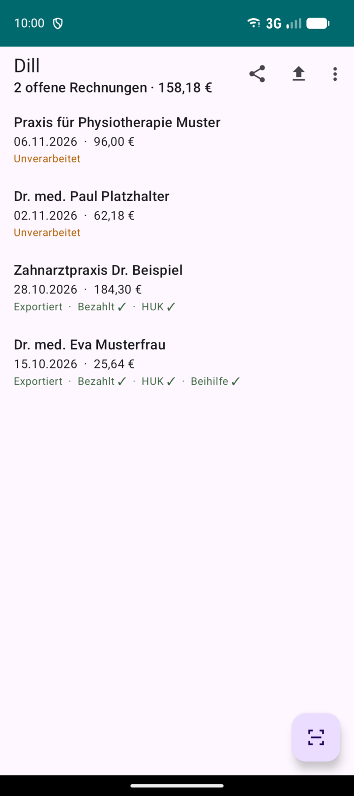
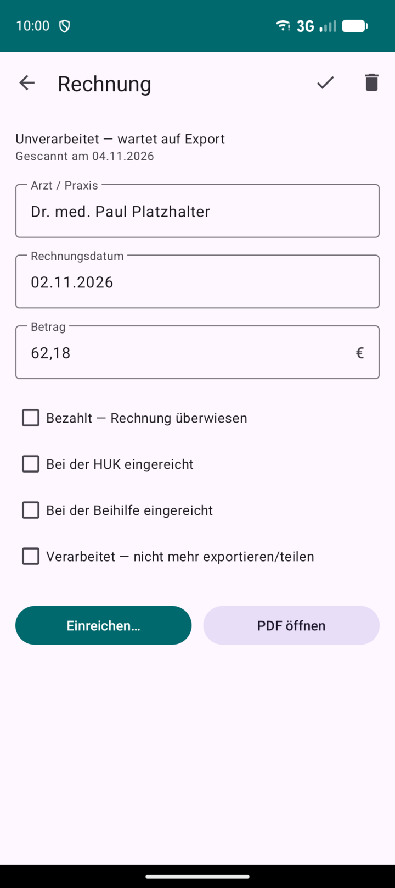

# Arztrechnungen als App

**Dill** sammelt Arztrechnungen für Privatversicherte und Beihilfeberechtigte. Die Rechnung wird
abfotografiert, die App liest Datum, Praxis und Betrag aus und reicht das PDF an die Apps der
Krankenversicherung (HUK) und der Beihilfe weiter. Häkchen zeigen, was schon eingereicht und bezahlt
ist. Die App ist noch eine frühe Version (0.x).

## So funktioniert's

1. **Scannen:** Der Knopf unten rechts startet den Dokumentenscanner. Er findet die Blattränder,
   schneidet zu, richtet gerade und macht das Bild gut lesbar. Vorhandene PDFs lassen sich auch
   importieren.
2. **Auslesen:** Die Texterkennung schlägt **Rechnungsdatum**, **Arzt/Praxis** und **Betrag** vor;
   in der Detailansicht lässt sich alles korrigieren.
3. **Einreichen:** „Einreichen…“ öffnet das Teilen-Menü von Android. Die Apps der HUK und der
   bayerischen Beihilfe nehmen das PDF direkt entgegen. Alternativ kopiert die App alle neuen
   Rechnungen in einen Übergabeordner, mit sprechenden Dateinamen wie
   `Arztrechnung_2026-07-15_Dr-med-Musterfrau_25-64-EUR.pdf`.
4. **Abhaken:** Pro Rechnung gibt es Häkchen für *bezahlt*, *bei der HUK eingereicht* und *bei der
   Beihilfe eingereicht*.

<table>
<tr>
<td width="50%"></td>
<td width="50%"></td>
</tr>
<tr>
<td><b>Übersicht:</b> neueste Rechnungen oben, oben die Summe der noch offenen. Neue Rechnungen
sind als <i>unverarbeitet</i> markiert.</td>
<td><b>Rechnung:</b> ausgelesene Angaben prüfen, Häkchen setzen, einreichen oder das PDF ansehen.</td>
</tr>
</table>

Die Rechnungen auf den Bildern sind erfunden.

## Kleine Details

- **Alles bleibt auf dem Handy:** Scan und Texterkennung laufen auf dem Gerät, die PDFs liegen im
  privaten Speicher der App. Es gibt kein Konto, keine Cloud und keinen Netzwerkzugriff.
- **Keine Berechtigungen:** Der Scanner braucht keine Kamera-Berechtigung, der Übergabeordner wird
  über die normale Ordnerauswahl von Android freigegeben.
- **Voraussetzung:** Der Scanner kommt aus den Google-Play-Diensten. Auf Geräten ohne sie (etwa
  Fire-Tablets) funktioniert nur der PDF-Import.

## Ausprobieren

Auf einem Android-Gerät (ab Version 8) die APK-Datei vom
[neuesten Release](https://github.com/hansmaulwurf23/dill/releases/latest) herunterladen und öffnen.
Android fragt einmal, ob Apps aus dieser Quelle installiert werden dürfen, und warnt eventuell, weil
die App nicht aus dem Play Store kommt; beides lässt sich bestätigen. Für iPhones gibt es die App
nicht.
